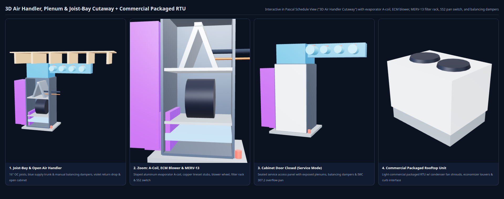
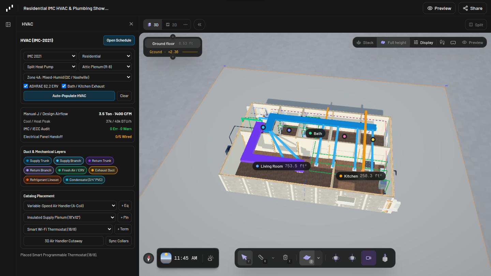
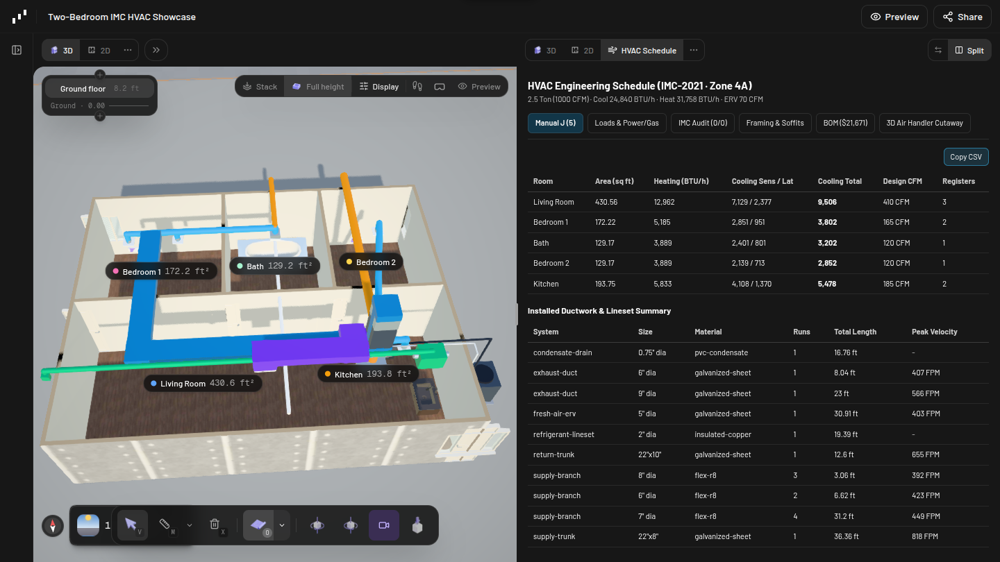

# Pascal Plugin HVAC (`@kruschdev/pascal-plugin-hvac`)

[](./LICENSE)
[](https://github.com/pascalorg/editor)
[](https://github.com/kruschdev/pascal-mep-kernel)
[](./docs/CAD-CATALOG.md)
[](./src/__tests__)

An open-source, MIT-licensed **Residential and Light-Commercial IMC / UMC / ACCA Manual J-D-S / ASHRAE 62.2 / IECC HVAC** plugin for [Pascal Editor](https://github.com/pascalorg/editor).

I built `@kruschdev/pascal-plugin-hvac` on top of [`@kruschdev/pascal-mep-kernel`](https://github.com/kruschdev/pascal-mep-kernel) to complete the 4-trade MEP stack inside Pascal Editor alongside Structural (Priority #1), Plumbing (Priority #2), and Electrical (Priority #4). Every calculation runs deterministically in TypeScript with zero cloud dependencies, zero global CSS, and strict runtime boundary isolation across all 6 subpath exports.

> [!NOTE]
> **Verification Status:** Verified with `95 / 95` deterministic unit tests (`1,669` assertions), `5 / 5` entry boundary gates, and audited across `246` real public Pascal buildings (`222 / 246` zero-error, `0` crashes, `0/0/0/0` errors on two-story Aymeric House with automatic West 4-Ton + East 2-Ton dual-wing zoning and zero courtyard ducts).

## 4-Trade Coordinated Cutaway (Shared `@kruschdev/pascal-mep-kernel`)


Watch the full two-story Aymeric House finished-to-cutaway walkthrough (Structural -> Plumbing -> Dual-Wing HVAC -> Electrical, `1,412` coordinated nodes, `0/0/0/0` errors) in [`@kruschdev/pascal-mep-kernel`](https://github.com/kruschdev/pascal-mep-kernel).

## Walkthrough Video (Recorded Live in Pascal Editor)


**[Watch Full 720p HD Narrated Walkthrough Video Recorded in Pascal Editor (`assets/demo-walkthrough.mp4`)](./assets/demo-walkthrough.mp4)**

1. **One-Click IMC / Manual J-D-S Auto-Populate & Catalog Placement**: Scans every room and exterior wall across all 14 ASHRAE Climate Zones (`1A` through `7`) to compute room-by-room heating and sensible/latent cooling BTU/h, select equipment tonnage (`SEER2` / `HSPF2`), A2L refrigerant linesets (`R-454B`, `R-32`, `R-410A`), continuous ASHRAE 62.2 ERV ventilation, bath exhaust fans, and vented kitchen range hoods, and drop in 26 live equipment, plenum, and terminal kinds directly from the HVAC rail.
2. **4-Trade Priority #3 Legal-Cavity Routing, Automatic Dual-Wing Zoning & 2D Floorplan**: Routes color-coded 3D rectangular trunks, R-8 flex/rigid branches, return drops, ERV fresh-air ducts, header-safe bath and kitchen range-hood exhaust runs, grounded exterior-wall copper refrigerant linesets, and gravity-sloped 3/4" PVC condensate drains via [`@kruschdev/pascal-mep-kernel`](https://github.com/kruschdev/pascal-mep-kernel) while yielding around Structural beams/columns, 3D door/window headers, and Priority #2 Plumbing DWV pipes. Concave U-shaped courtyard houses and >5-Ton residences automatically split into independent dual-wing systems (`<= 5 Ton` each) with zero ducts bridging open courtyards. Toggle any of the 8 mechanical layers live or switch to the color-matched 2D HVAC floorplan schematic.
3. **Interactive 3D Air Handler, Supply/Return Plenum & Joist-Bay Cutaway**: Opens inside Pascal's split-pane `HVAC Schedule` view with live drag-to-orbit and 3 view modes (`Joist-Bay & Open Air Handler`, `Cabinet Cover Off`, `Cabinet Door Closed`) showing the overhead 16" OC joists, evaporator A-coil, copper lineset stubs, ECM blower housing, MERV-13 filter rack, secondary galvanized overflow pan with SS2 float switch (`IMC 307.2`), manual balancing dampers, and live room branch tags.
4. **Live Manual J Schedule, Manual S Sizing & Cross-Trade Power/Gas Handoff**: Inspects room-by-room heating/cooling loads and airflows, installed ductwork velocities (`FPM`), Manual S capacity and lineset sizing, structural framing/soffit clearances (`IRC R502.8 / R602.6 / R302.11`), furnace `gasBtuh` sync for `@kruschdev/pascal-plugin-plumbing`, and automatic `NEC Art. 440 / 424` breaker handoff to `@kruschdev/pascal-plugin-electrical`.
5. **Live Priced BOM + IECC Envelope Insulation & IMC/IECC Audit**: Adjust Labor (`$/hr`), Material Markup (`%`), Sales Tax (`%`), and optional IECC building envelope insulation (wall batts, attic cellulose, rim-joist spray foam, air sealing) with one-click CSV export alongside the live IMC / Manual D / IECC / `NEC 110.26(E)` compliance audit.

## Showcase Gallery








### 42-Model Clean-Room MIT CAD Library (6 Categories)

| Category | Count | Included Highlights |
|---|---|---|
| **Heat Pumps, Furnaces & Mechanical Equipment** | 12 | 3-Ton Split Heat Pump & AC Condensers (`SEER2`), Variable-Speed Air Handler w/ A-Coil, 96% & 80% AFUE Gas Furnaces, Commercial Packaged Rooftop Unit (RTU), Inverter Multi-Zone Mini-Split Outdoor & Wall Heads, ASHRAE 62.2 ERV, Whole-House Ducted Dehumidifier, Bath Exhaust Fan, Vented Kitchen Range Hood |
| **Plenums & Zone Damper Manifolds** | 4 | Insulated Sheet-Metal Supply Plenum, Return Air Plenum & Filter Box, Fresh-Air / Return Mixing Box, Motorized Multi-Zone Damper Trunk Manifold |
| **Registers, Grilles & Smart Controls** | 10 | 4x10 Floor Supply Register + Boot, Ceiling 4-Way Diffuser, High-Sidewall Register, Filter-Back Central Return Grille, Bedroom Transfer Grille, Ceiling Exhaust Grille, Exterior Fresh-Air Intake Hood, Mini-Split Wall Head, Smart Wi-Fi Thermostat (`18/8`), Remote Room Temp/RH Sensor |
| **Duct Fittings, Boots & Transitions** | 9 | Rectangular 90° Trunk Elbow, Sheet-Metal Trunk Transition Reducer, 45° Round Duct Wye Branch, Start Collar w/ Manual Balancing Damper, 4x10 Floor End Boot, R-8 Insulated Ceiling Register Box, Motorized 24V Round Zone Damper, R-8 Insulated Flex Duct, Roof Exhaust Vent Jack w/ Backdraft Damper |
| **Lineset, Condensate & Electrical Accessories** | 5 | 36x36 Composite Condenser Pad, 60A Weatherproof AC Disconnect (`NEC 440.14`), Insulated Copper Refrigerant Lineset Pair, 3/4" PVC Condensate P-Trap & SS2 Float Switch (`IMC 307.2.3`), MERV-13 4" Media Filter Rack |
| **Air Handler & Joist-Bay Cutaway Assemblies** | 2 | 3D Air Handler, Supply/Return Plenum & Joist-Bay Cutaway (`IRC R502.8`), 3D Air Handler Cover-Off Evaporator A-Coil & Blower View |

> **Drafting and engineering aid, not stamped engineering.** Always verify Manual J/D/S calculations, duct sizing, clearances, and local AHJ amendments with a licensed mechanical engineer or HVAC contractor before construction.

## Core Principle: 4-Trade MEP Coordination (Priority #3)

1. **Priority #1 Structural & Bones Framing**: Reads `structural:assembly` and `bones:framing` framing metadata (stud spacing, joist depth, floor system, load-bearing wall overrides) to evaluate wall penetration openings, double top-plate straps, and dropped-soffit chases per `IRC R502.8 / R602.6 / R302.11`, and detours ductwork around `structural:beam` and `structural:column` obstacles.
2. **Priority #2 Plumbing**: Detours ductwork around gravity DWV drains, stacks, manifolds, and plumbing equipment without forcing gravity drains to move. Gas furnaces publish `gasBtuh` so `@kruschdev/pascal-plugin-plumbing` automatically includes furnace demand in its IFGC fuel-gas main sizing.
3. **Priority #3 HVAC (`hvac:*`)**: Sizes and routes rigid trunks, R-8 flex branches, ERV ducts, exhaust ducts, insulated copper refrigerant linesets, and gravity-sloped 3/4" PVC condensate drains while respecting `NEC 110.26(E)` dedicated electrical space down to the floor (`minY = 0`).
4. **Priority #4 Electrical**: Every powered `hvac:equipment` node publishes a standardized `electricalDemand` payload (`NEC Art. 440 / 424` voltage, poles, breaker amps, VA, dedicated circuit flag) consumed automatically by `@kruschdev/pascal-plugin-electrical`.

## Installation & Subpath Exports

```bash
bun add @kruschdev/pascal-plugin-hvac
```

| Subpath | Purpose | Runtime Constraints |
|---|---|---|
| `@kruschdev/pascal-plugin-hvac` | Full Pascal Editor plugin, left-rail panel, 6-tab schedule view, inspector card, chat cards | Browser + `@pascal-app/editor` |
| `@kruschdev/pascal-plugin-hvac/render` | Read-only 3D/2D node renderer manifest (`hvacRenderPlugin`) | Zero `@pascal-app/editor` or `next` |
| `@kruschdev/pascal-plugin-hvac/imc` | Pure Manual J/D/S, ASHRAE 62.2, IECC, routing, audit, schedule, and BOM engine | Zero React, Three.js, or `@pascal-app/*` |
| `@kruschdev/pascal-plugin-hvac/cad` | 42 procedural MIT Three.js CAD builders + cutaway model | Zero React or `@pascal-app/*` |
| `@kruschdev/pascal-plugin-hvac/agent-tools` | 8 Zod tool declarations for Pascal AI Chat & MCP | Zero React, Three.js, or `@pascal-app/editor` |
| `@kruschdev/pascal-plugin-hvac/agent-operations` | Pure scene operations returning `{ result, changes }` | Zero React, Three.js, or `@pascal-app/editor` |

## Host Registration Example

```ts
import { extendPluginDiscovery } from '@pascal-app/core'
import { registerEditorHostPanel, registerEditorHostView, registerPluginChatExtension } from '@pascal-app/editor'
import {
  hvacChatExtension,
  hvacHostPanel,
  hvacPlugin,
  hvacScheduleView,
} from '@kruschdev/pascal-plugin-hvac'

extendPluginDiscovery(async () => [hvacPlugin])
registerEditorHostPanel(hvacHostPanel)
registerEditorHostView(hvacScheduleView)
registerPluginChatExtension(hvacChatExtension)
```

## Documentation

| Guide | What It Covers |
|---|---|
| **[Architecture & Trade Priority](./docs/ARCHITECTURE.md)** | System diagram, 6 entrypoint boundary gates, 4 `hvac:*` node kinds, Priority #3 routing, and 3D cutaway pipeline |
| **[IMC / ACCA / IECC Engineering Reference](./docs/IMC-REFERENCE.md)** | Manual J (14 ASHRAE zones), Manual D equal-friction + Huebscher `Deq`, Manual S A2L linesets, ASHRAE 62.2 ERV, IECC insulation, and audit rules |
| **[42-Model MIT 3D CAD Catalog](./docs/CAD-CATALOG.md)** | Full inventory of all 42 `.glb` models across 6 categories, code references, and programmatic `./cad` usage |
| **[Agent Tools & Operations Reference (`E-016`)](./docs/AGENT-TOOLS.md)** | All 8 pure Zod agent tools and headless scene operations for MCP servers and Pascal AI Chat |
| **[Media Kit & Launch Copy](./docs/MEDIA-KIT.md)** | Social preview (`1280 x 640`), HD narrated walkthrough video, high-res screenshots, CAD contact sheet, and launch copy |
| **[Walkthrough Voiceover Script](./docs/WALKTHROUGH-SCRIPT.md)** | Timed `87.0s` narration beat sheet and one-command Gemini TTS (`gemini-3.8-flash-tts`) + `ffmpeg` muxing script (`scripts/add-voiceover.sh`) |

## Development & Verification

```bash
bun install
bun run check              # tsc + 95/95 tests + 5/5 entry boundary gates + ESM build
bun run export:cad         # Export all 42 .glb CAD assets into assets/cad/
bun run render:cad-thumbs  # Re-render all 42 thumbnails + 6x7 contact sheet
bun run render:cutaway     # Re-render 4-panel 3D Air Handler Cutaway showcase
PASCAL_EDITOR_URL=http://localhost:3210/project/<id> bun run render:walkthrough
bun run render:social      # Re-render 1280x640 OpenGraph social preview
bash scripts/add-voiceover.sh --voice Charon
```

## License

MIT. Created by Kevin Ruschman ([@kruschdev](https://github.com/kruschdev)). See [LICENSE](LICENSE).
